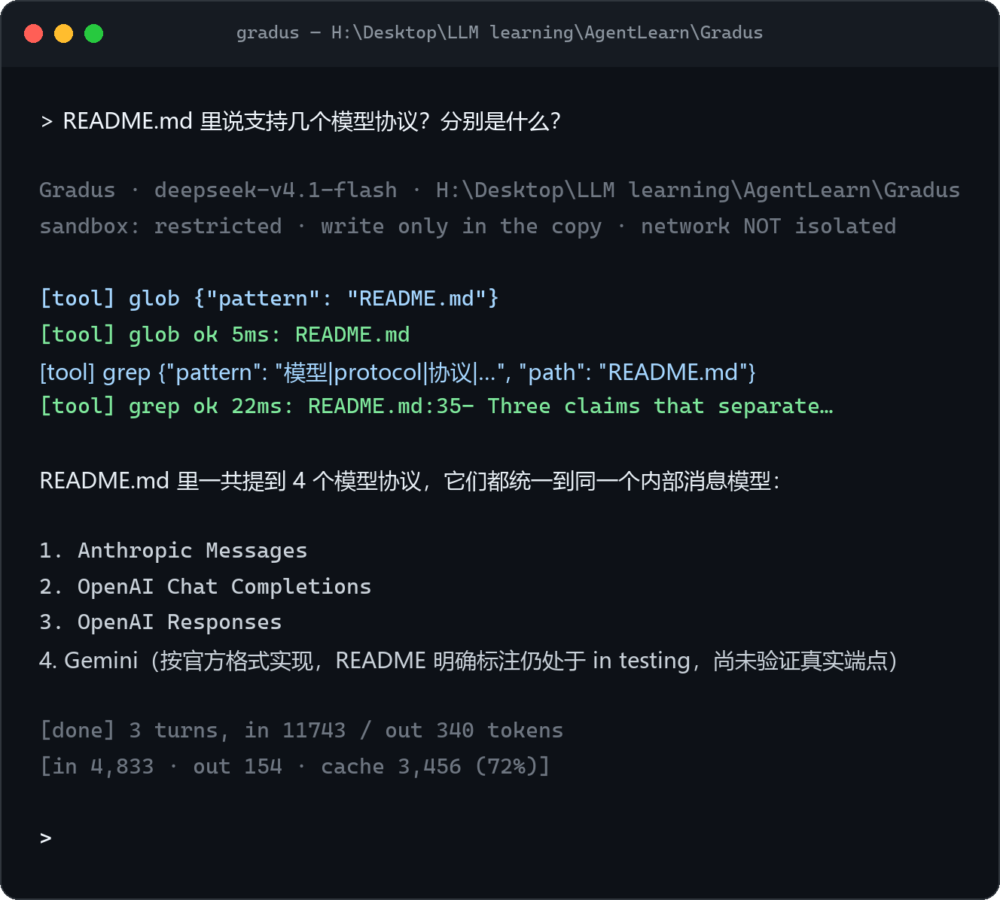

<div align="center">

<picture>
  <source media="(prefers-color-scheme: dark)" srcset="docs/banner-dark.svg">
  
</picture>

[](https://github.com/xyzhhh123/Gradus/actions/workflows/ci.yml)


**계층화된 코딩 에이전트 런타임.** Gradus는 모델의 스트림을 도구를 쓰는 세션으로 바꾸고, 세션마다 워크스페이스의 사설 복사본을 주며, 세션이 끝나면 호스트로 다시 병합합니다.

[English](README.md) · [中文](README.zh.md) · [日本語](README.ja.md) · [한국어](README.ko.md)

<br>


<sub>한 턴: 스트리밍 응답 → <code>bash</code> 도구 호출 → 그 결과.</sub>

</div>

Python 3.13과 모델이 필요합니다 — `.env`에 세 줄. 자세한 절차는 [빠른 시작](#-빠른-시작)에 있습니다.

```bash
git clone https://github.com/xyzhhh123/Gradus.git
cd Gradus && uv sync
uv run gradus
```

## 🎯 Gradus란

흔한 에이전트 하네스와 다른 세 가지 주장이 있습니다.

1. 🧠 **트랜스크립트는 세션이 소유하고, 제공자는 소유하지 않습니다.** 히스토리는 제공자 중립적인 표현으로 저장되고 요청마다 번역되므로, 하나의 세션이 대화 도중에 Anthropic·OpenAI·Gemini 형식 엔드포인트 사이를 이동할 수 있습니다. thinking 블록의 `signature` 같은 벤더 전용 필드는 넘어오지 않지만, 나머지는 모두 넘어옵니다.
2. 📦 **에이전트는 워크스페이스를 직접 편집하지 않습니다.** 모든 세션은 복사본 위에서 동작하고(워크스페이스가 저장소면 `git worktree`, 아니면 필터링된 트리 복사본), 변경은 종료할 때만 병합됩니다. 프로세스가 강제 종료되어도 잃을 것이 없습니다.
3. 🧰 **이것은 런타임이지 앱이 아닙니다.** 네 개의 패키지, import는 단방향. `ai`는 상위 계층을 전혀 모르므로 프로토콜 계층만 떼어 쓸 수 있습니다. `agent`는 루프와 파사드를 주고, CLI는 딸려오지 않습니다.

## ✨ 특징

- 🔌 **네 가지 모델 프로토콜, 하나의 내부 표현** — Anthropic Messages, OpenAI Chat Completions, OpenAI Responses, Gemini를 하나의 메시지 모델과 12개의 스트리밍 이벤트로 환원합니다. Gemini는 공식 포맷에 맞춰 구현했지만 여전히 **테스트 중**입니다(실제 엔드포인트로 검증되지 않음).
- 🔁 **제어 가능한 도구 루프** — 단일 비동기 루프, 9개의 훅, 8개의 실행 수준 이벤트, 병렬 도구 실행, `steer` / `follow_up`, 취소, 재시도.
- 🛡️ **샌드박스 실행** — Windows에서 관리자 권한 없이 쓰는 `restricted`, 그리고 `appcontainer`(폐기됨), `docker`, `local`. [샌드박스](#-샌드박스)를 참고하세요.
- 👥 **에이전트가 하나가 아닙니다** — 멀티 에이전트 팀, 백그라운드 작업, 예약 작업, 트랜스크립트 recall이 `coding` 계층의 도구로 함께 들어 있습니다.
- 🧩 **MCP와 확장** — 프로젝트 단위 MCP 서버(명시적 신뢰 + OAuth), 그리고 `.gradus/`에서 읽어 오는 Python 도구, 슬래시 명령, `SKILL.md` 스킬.
- 🐍 **Codemode** — 모델이 `tools.*`를 호출하는 Python을 쓰고, `text()` / `return`의 결과만 컨텍스트에 들어갑니다.
- 💾 **세션과 컨텍스트** — JSONL 히스토리, 재개, 토큰 예산, 자동 압축, 세션 중 모델 전환.

## 🚀 빠른 시작

### 💻 CLI 실행

```bash
uv sync
```

저장소를 남기고 싶지 않다면 도구로 설치할 수 있습니다:

```bash
uv tool install git+https://github.com/xyzhhh123/Gradus
```

아래 예시는 `uv run gradus` 대신 `gradus`로 실행하면 됩니다.

`<workspace>/.env`에 연결 설정을 한 덩어리로 적습니다:

```ini
GRADUS_SERVICE=kimi-compat
GRADUS_MODEL=kimi-k2.7-code
GRADUS_API_KEY=sk-...
```

```bash
uv run gradus                      # workspace = 현재 디렉터리
uv run gradus --workspace ../app   # 다른 위치를 지정할 수도 있습니다
uv run gradus --sandbox docker     # auto -> restricted -> appcontainer -> docker -> local
```

키만으로는 제공자를 식별할 수 없으므로 service, model, key를 함께 설정합니다. 우선순위는 CLI 플래그, 그다음 `.env`, 그다음 `~/.gradus/config.json`입니다.

REPL 안에서 `/reload`는 도구와 확장을 다시 만들고, `/command`와 `/skill:name`은 저장된 프롬프트를 펼치며, `exit` 또는 `Ctrl-D`로 빠져나옵니다.

<div align="center">

  

  <sub>한 턴: 도구 호출 두 번 뒤에 답변, 끝에 토큰 내역.</sub>

</div>

### 🌐 웹 UI 실행

프로세스는 두 개입니다. Python 호스트와 브라우저 번들이며, 호스트를 먼저 띄웁니다.

```bash
uv sync --extra web
uv run gradus-serve --port 8765 --token dev
```

토큰이 포함된 주소를 출력합니다:

```
Gradus web · kimi-k2.7-code · H:\your\workspace
open: http://127.0.0.1:8765/?token=dev
```

토큰은 선택 사항이 아닙니다. 올바른 토큰이 없으면 `/ws`는 4401로 닫힙니다. `--token`을 빼면 호스트가 무작위로 생성해 그 URL을 출력합니다.

그다음 둘 중 하나를 고릅니다:

```bash
cd web && npm install && npm run build   # 호스트가 web/dist를 서빙 — 출력된 주소를 여세요
cd web && npm run dev                    # Vite는 :5173, /ws를 127.0.0.1:8765로 프록시
```

개발 서버를 쓴다면 `http://localhost:5173/?token=dev`를 엽니다. 프런트엔드는 페이지 URL에서 `token`을 읽으므로 `--token`과 일치해야 합니다. `&mock=1`을 붙이면 호스트 없이 스크립트화된 연결로 UI를 볼 수 있습니다.

`gradus/` 아래를 수정하면 호스트를 재시작하세요. 프런트엔드는 저장 시 스스로 리로드됩니다.

### 🧪 테스트 실행

```bash
uv run pytest -q
```

오프라인에서 1002개가 약 95초에 통과합니다. 별도로 15개의 실기 검사가 기본적으로 건너뛰어집니다. 샌드박스 계약은 `GRADUS_SANDBOX_LIVE=1`, 컨테이너 테스트는 `GRADUS_DOCKER_LIVE=1`이 필요합니다.

## 🔒 샌드박스

| 백엔드 | 사용 시점 | 경계 |
| --- | --- | --- |
| 🪟 `restricted` | Windows. `auto`가 가장 먼저 고름 | 제한 토큰(합성 SID + 로그온 SID + `Everyone`). 읽기는 계정을 따르고, 쓰기는 복사본과 스크래치에만 떨어집니다. **네트워크 격리는 없습니다.** 관리자 권한 불필요, 추가 설치 불필요. |
| 🪟 `appcontainer` | Windows. `restricted`를 쓸 수 없을 때만 | AppContainer 토큰, 네트워크 없음, Job Object가 자식 프로세스를 종료합니다. **폐기됨**: 동작은 유지하지만 더 이상 작업하지 않습니다. |
| 🐳 `docker` | Docker 엔진이 있을 때 | `--network none`, 메모리 / CPU / PID 제한이 걸린 컨테이너. **테스트 중**: 크로스 플랫폼 폴백으로 유지하지만 실제 엔진으로 검증되지 않았습니다. |
| 🏠 `local` | 폴백 | 없음. 명령이 사용자 권한으로 실행됩니다 |

샌드박스 세션은 워크스페이스를 직접 편집하지 않습니다. 사설 복사본을 받고(워크스페이스가 git 저장소면 `git worktree`, 아니면 필터링된 트리 복사본), 파일 도구와 명령이 모두 그 복사본 위에서 동작합니다. 종료할 때 추가·수정된 파일은 되쓰고 삭제는 적용되며, 병합에 실패하면 복사본을 보존하고 그 경로를 출력합니다. 강제 종료된 프로세스가 남긴 복사본은 다음 시작 시 정리됩니다.

솔직히 적어 둘 경계가 세 가지 있습니다:

- ⚠️ **`restricted`는 네트워크를 막지 않습니다.** 쓰기 경계는 진짜지만 네트워크는 그렇지 않습니다. 명령이 반드시 오프라인이어야 한다면 `docker`를 쓰세요.
- 🔒 **명령 승인은 그대로 켜져 있습니다.** 복사본은 호스트를 실수로부터 지킬 뿐, 임의의 명령을 안전하게 만들지는 않습니다.
- 🚫 **MCP 서버 프로세스는 샌드박스 안에 없습니다.** 그것들은 사용자 권한으로 호스트에서 돕니다. stdio 서버의 기본 `cwd`는 상대 경로가 맞도록 복사본을 가리키지만, HTTP 서버와 절대 경로는 여전히 호스트에 닿습니다.

## 🧱 아키텍처

```
gradus/host      web layer      호스트 프로세스, wire 프로토콜, 시계
gradus/coding    product layer  설정, 세션, 도구, 권한, 샌드박스, MCP, CLI
gradus/agent     control layer  루프, 훅, 병렬 도구, Agent 파사드
gradus/ai        protocol layer 제공자, 스트리밍 이벤트, 전송
```

의존성은 아래로만 향합니다. `ai`는 `agent`도 `coding`도 import하지 않고, `agent`는 `coding`을 import하지 않으며, `coding`은 `host`를 import하지 않습니다.

### 📐 설계 원칙

1. ⬇️ **의존성은 아래로만.** 상위 계층은 하위 계층을 부를 수 있지만, 하위 계층은 상위 계층을 결코 보지 않습니다.
2. 📡 **이벤트가 인터페이스.** 12개의 `ai` 이벤트는 `agent`가 그대로 전달하며, `agent`가 더하는 것은 실행 수준 이벤트뿐입니다.
3. ⚡ **전 구간 비동기.** `Provider.stream()`, `run_loop()`, `AgentTool.execute()`는 모두 async이고, 루프는 I/O에서 블로킹되지 않습니다.
4. 🔧 **도구는 상위 계층에 속합니다.** `agent`가 `AgentTool` 프로토콜을 정의하고, 파일·검색·셸 구현은 `coding`에 있습니다.

## 🐍 Python API

네트워크도 API 키도 없이 루프 하나를 끝까지 돌려 봅니다:

```python
import asyncio

from gradus.agent.base import LoopConfig
from gradus.agent.loop import run_loop
from gradus.agent.types import AgentDone
from gradus.ai.base import ModelSpec
from gradus.ai.providers.fake import FakeProvider
from gradus.ai.types import UserMessage

spec = ModelSpec(
    provider="fake",
    model="fake",
    base_url="",
    context_window=8192,
    max_output_tokens=1024,
)
provider = FakeProvider(
    spec,
    scripts=[{
        "name": "answer",
        "steps": [
            {"kind": "text", "chunks": ["Hello, ", "I am Gradus"]},
            {"kind": "finish", "reason": "stop"},
        ],
    }],
)

async def main() -> None:
    async for event in run_loop(provider, [UserMessage("hi")], LoopConfig(system="")):
        if isinstance(event, AgentDone):
            print(event.new_messages[-1].content[0].text)

asyncio.run(main())
```

실제 모델은 상태를 가진 `Agent` 파사드로 씁니다:

```python
from gradus.agent.agent import Agent
from gradus.agent.base import LoopConfig
from gradus.ai.base import ModelSpec

spec = ModelSpec(
    provider="anthropic",
    model="claude-sonnet-4-5",
    base_url="https://api.anthropic.com",
    context_window=200_000,
    max_output_tokens=8192,
)

agent = await Agent.connect(
    spec,
    LoopConfig(system="You are a helpful assistant"),
    api_key="sk-...",
)
try:
    async for event in agent.prompt("hi"):
        ...
finally:
    await agent.aclose()
```

`Agent.connect()`는 `httpx.AsyncClient` 하나를 만들어 여러 실행에 재사용하고, `aclose()`가 그것을 닫습니다. 같은 `client`를 여러 `connect()`에 넘기면 풀을 공유합니다.

## 📖 레퍼런스

### 🚩 CLI 플래그

| 플래그 | 용도 |
| --- | --- |
| `--workspace` | 도구와 명령의 루트 (기본값: 현재 디렉터리) |
| `--sandbox` | `auto` / `local` / `docker` / `appcontainer` / `restricted` |
| `--service` / `--provider` / `--model` / `--base-url` | 연결 설정 덮어쓰기 |
| `--resume` / `--session-dir` | JSONL 세션 재개, 또는 새 세션 저장 위치 지정 |
| `--mcp` / `--config` | MCP와 설정 파일 경로를 명시 |
| `--untrust [path]` | 프로젝트 MCP 설정의 신뢰를 철회하고 종료 |
| `--reset-sandbox` | 고아 복사본, AppContainer 부여, 프로필 정리 |
| `--log` | 도구와 오류 이벤트를 JSONL에 추가 기록 |

### 🧩 후보 모델

웹 모델 선택기, 설정 패널, 테마 전환은 **[docs/web-ui.md](docs/web-ui.md)**에 정리되어 있습니다.

### 📁 디렉터리 구조

```
Gradus/
├── gradus/
│   ├── ai/          # 제공자, 내부 프로토콜, 스트리밍 이벤트, 전송
│   ├── agent/       # 루프, 훅, 도구 런타임, 상태를 가진 Agent
│   ├── coding/      # 설정, 세션, 도구, 권한, 샌드박스, MCP, CLI
│   └── host/        # 웹 호스트 프로세스, wire 프로토콜, 시계
├── bench/           # 벤치마크 하네스
├── web/             # 브라우저 번들
├── pyproject.toml
└── uv.lock
```

Python 3.13 · 런타임 의존성: `httpx`, `httpx2`, `jsonschema`, `mcp` · `uv`로 관리.

## 📚 문서

| 계층 | README | 설계 | 계획 |
| --- | --- | --- | --- |
| `ai` | [README](gradus/ai/README.md) | [설계](gradus/ai/docs/design.md) | [계획](gradus/ai/ai_plan.md) |
| `agent` | [README](gradus/agent/README.md) | [설계](gradus/agent/docs/design.md) | [계획](gradus/agent/agent_plan.md) |
| `coding` | [README](gradus/coding/README.md) | [설계](gradus/coding/docs/design.md) | [계획](gradus/coding/coding_plan.md) |

`gradus/coding/docs/`의 관련 자료: [샌드박스](gradus/coding/docs/sandbox.md) · [컨텍스트 설계](gradus/coding/docs/context_design.md) · [멀티 에이전트](gradus/coding/docs/multi_agent.md) · [백그라운드 작업](gradus/coding/docs/background_tasks.md) · [예약 작업](gradus/coding/docs/cron_tasks.md) · [recall](gradus/coding/docs/recall.md).

## 🙏 감사의 말

Gradus의 계층 구조, 이벤트 모델, 도구 계약은 다음 오픈소스 프로젝트를 참고했습니다:

- **Pi** (`@earendil-works/pi-agent-core`): 에이전트 루프, 훅 시스템, steering / follow-up, 도구 프로토콜의 참조.
- **OpenCode**: API와 도구 설계의 참조.

## 📄 라이선스

[MIT](LICENSE)
