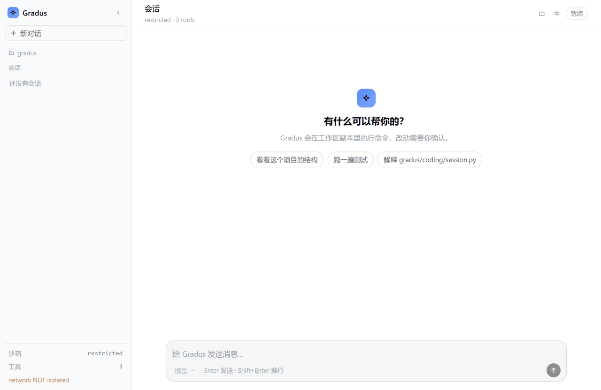
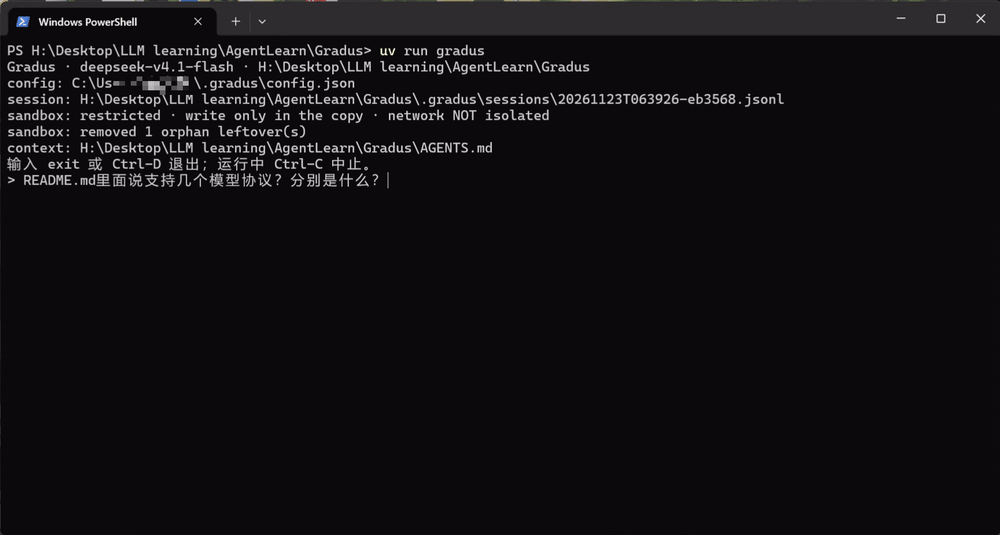

<div align="center">

<picture>
  <source media="(prefers-color-scheme: dark)" srcset="../../docs/banner-dark.svg">
  
</picture>

[](https://github.com/xyzhhh123/Gradus/actions/workflows/ci.yml)


**Eine geschichtete Laufzeitumgebung für Coding-Agenten.** Gradus macht aus dem Modell-Stream Sessions, die Werkzeuge benutzen, und gibt jeder Session eine private Kopie des Workspace, die beim Beenden zurückgeführt wird.

[English](en.md) · [中文](../../README.md) · [日本語](ja.md) · [한국어](ko.md) · [Español](es.md) · [Français](fr.md) · [Deutsch](de.md)

<br>



<sub>Ein Turn: gestreamte Antwort → <code>bash</code>-Aufruf → sein Ergebnis.</sub>

</div>

Benötigt Python 3.13 und ein Modell (drei Zeilen in `.env`). Alle Schritte unter [Schnellstart](#-schnellstart).

```bash
git clone https://github.com/xyzhhh123/Gradus.git
cd Gradus && uv sync
uv run gradus
```

## 🎯 Warum Gradus

Drei Aussagen, die es vom üblichen Agent-Harness unterscheiden.

1. 🧠 **Das Transkript gehört der Session, nicht dem Anbieter.** Der Verlauf liegt in einer anbieterneutralen Darstellung und wird pro Anfrage übersetzt, sodass eine Session mitten im Gespräch zwischen Endpunkten im Anthropic-, OpenAI- und Gemini-Stil wechseln kann. Anbieterspezifische Felder — etwa die `signature` eines Reasoning-Blocks — überstehen den Wechsel nicht, alles andere schon.
2. 📦 **Der Agent bearbeitet deinen Workspace nie direkt.** Jede Session arbeitet auf einer Kopie — ein `git worktree`, wenn der Workspace ein Repository ist, sonst ein gefilterter Baum — und Änderungen werden erst beim Schließen zusammengeführt. Ein abgeschossener Prozess kostet dich nichts.
3. 🧰 **Das ist eine Laufzeitumgebung, keine Anwendung.** Vier Pakete, Importe nur in eine Richtung. `ai` weiß nichts von den Schichten darüber, du kannst also nur die Protokollschicht mitnehmen; `agent` liefert eine Schleife und eine Fassade, ohne angehängte CLI.

## ✨ Funktionen

- 🔌 **Vier Modellprotokolle, eine interne Form** — Anthropic Messages, OpenAI Chat Completions, OpenAI Responses und Gemini werden auf ein Nachrichtenmodell plus 12 Streaming-Events reduziert. Gemini folgt dem dokumentierten Format und ist weiterhin **im Test** (kein echter Endpunkt verifiziert).
- 🔁 **Eine Werkzeugschleife mit echter Kontrolle** — eine asynchrone Schleife, 9 Hooks, 8 Ereignisse auf Ausführungsebene, parallele Werkzeuge, `steer` / `follow_up`, Abbruch und Wiederholungen.
- 🛡️ **Ausführung in der Sandbox** — `restricted` unter Windows ohne Adminrechte, dazu `appcontainer` (veraltet), `docker` und `local`. Siehe [Die Sandbox](#-die-sandbox).
- 👥 **Mehr als ein Agent** — Multi-Agent-Teams, Hintergrundaufgaben, geplante Aufgaben und Transkript-Recall kommen als Werkzeuge in der Schicht `coding` mit.
- 🧩 **MCP und Erweiterungen** — projektbezogene MCP-Server mit ausdrücklichem Vertrauen und OAuth, dazu Python-Werkzeuge, Slash-Befehle und `SKILL.md`-Skills aus `.gradus/`.
- 🐍 **Codemode** — das Modell schreibt Python, das `tools.*` aufruft; nur `text()` / `return` landen im Kontext.
- 💾 **Sessions und Kontext** — JSONL-Verlauf, Fortsetzen, Token-Budget, automatische Kompaktierung, Modellwechsel mitten in der Session.

## 🚀 Schnellstart

### 💻 Die CLI starten

```bash
uv sync
```

Oder installiere sie als Werkzeug, wenn du keinen Repo-Checkout behalten willst:

```bash
uv tool install git+https://github.com/xyzhhh123/Gradus
```

Die Beispiele unten laufen dann als `gradus` statt `uv run gradus`.

Schreibe einen Verbindungsblock in `<workspace>/.env`:

```ini
GRADUS_SERVICE=kimi-compat
GRADUS_MODEL=kimi-k2.7-code
GRADUS_API_KEY=sk-...
```

```bash
uv run gradus                      # workspace = aktuelles Verzeichnis
uv run gradus --workspace ../app   # oder woandershin zeigen lassen
uv run gradus --sandbox docker     # auto -> restricted -> appcontainer -> docker -> local
```

Ein Schlüssel allein identifiziert keinen Anbieter, deshalb werden Dienst, Modell und Schlüssel zusammen konfiguriert. CLI-Flags überschreiben `.env`, das wiederum `~/.gradus/config.json` überschreibt.

Im REPL: `/reload` baut Werkzeuge und Erweiterungen neu, `/command` und `/skill:name` entfalten gespeicherte Prompts, `exit` / `Ctrl-D` beendet.

<div align="center">

  

  <sub>Aufgenommen im Windows Terminal: ein Turn, zwei Werkzeugaufrufe, dann die Antwort.</sub>

</div>

### 🌐 Die Weboberfläche starten

Zwei Prozesse: der Python-Host und das Browser-Bundle. Zuerst den Host starten:

```bash
uv sync --extra web
uv run gradus-serve --port 8765 --token dev
```

Er gibt die Adresse inklusive Token aus. Bundle bauen, Dev-Proxy, Token-Regeln, Mock-Modus, Modellwähler und Themenwechsel: **[docs/web-ui.md](../../docs/web-ui.md)**.

### 🧪 Die Tests ausführen

```bash
uv run pytest -q
```

1002 Tests laufen offline durch, in etwa 95 Sekunden. Weitere 15 sind Live-Prüfungen, die standardmäßig übersprungen werden: Sandbox-Verträge brauchen `GRADUS_SANDBOX_LIVE=1`, Container-Tests `GRADUS_DOCKER_LIVE=1`.

## 🔒 Die Sandbox

| Backend | Wann es genutzt wird | Grenze |
| --- | --- | --- |
| 🪟 `restricted` | Windows; `auto` wählt es zuerst | Eingeschränktes Token (synthetische SID + Anmelde-SID + `Everyone`): Lesen folgt deinem Konto, Schreiben landet nur in der Kopie und im Scratch. **Keine Netzwerkisolation.** Kein Admin, keine Zusatzinstallation. |
| 🪟 `appcontainer` | Windows; nur wenn `restricted` nicht verfügbar ist | AppContainer-Token, kein Netzwerk, ein Job Object beendet Kindprozesse. **Veraltet**: bleibt funktionsfähig, keine weitere Arbeit. |
| 🐳 `docker` | Docker-Engine vorhanden | Container mit `--network none`, Speicher- / CPU- / PID-Limits. **Im Test**: als plattformübergreifender Rückfall behalten, noch nicht gegen eine echte Engine geprüft. |
| 🏠 `local` | Rückfall | Keine; Befehle laufen mit deinen Benutzerrechten |

Eine Sandbox-Session bearbeitet deinen Workspace nie direkt. Sie bekommt eine private Kopie — `git worktree`, wenn der Workspace ein Git-Repository ist, sonst eine gefilterte Baumkopie — und sowohl Dateiwerkzeuge als auch Befehle arbeiten auf dieser Kopie. Beim Schließen werden hinzugefügte und geänderte Dateien zurückgeschrieben, Löschungen angewendet, und eine fehlgeschlagene Zusammenführung behält die Kopie und gibt ihren Pfad aus. Kopien, die ein abgeschossener Prozess hinterlässt, werden beim nächsten Start entfernt.

Drei Grenzen, die man klar benennen sollte:

- ⚠️ **`restricted` blockiert das Netzwerk nicht.** Die Schreibgrenze ist echt, die Netzgrenze nicht. Nimm `docker`, wenn ein Befehl offline laufen muss.
- 🔒 **Die Befehlsfreigabe bleibt aktiv.** Die Kopie schützt den Host vor versehentlichem Schaden; sie macht beliebige Befehle nicht sicher.
- 🚫 **MCP-Serverprozesse liegen nicht in der Sandbox.** Sie laufen mit deinen Rechten auf dem Host. Das Standard-`cwd` eines stdio-Servers zeigt auf die Kopie, damit relative Pfade passen, aber HTTP-Server und absolute Pfade erreichen weiterhin den Host.

## 🧱 Architektur

```
gradus/host      web layer      Host-Prozess, Wire-Protokoll, Uhr
gradus/coding    product layer  Konfiguration, Sessions, Werkzeuge, Rechte, Sandbox, MCP, CLI
gradus/agent     control layer  Schleife, Hooks, parallele Werkzeuge, Agent-Fassade
gradus/ai        protocol layer Anbieter, Streaming-Events, Transport
```

Abhängigkeiten zeigen nur nach unten. `ai` importiert weder `agent` noch `coding`; `agent` importiert nie `coding`; `coding` importiert nie `host`.

### 📐 Entwurfsprinzipien

1. ⬇️ **Abhängigkeiten zeigen nur nach unten.** Höhere Schichten dürfen niedrigere aufrufen; niedrigere sehen höhere nie.
2. 📡 **Ereignisse sind die Schnittstelle.** Die 12 `ai`-Events werden von `agent` unverändert weitergereicht, das nur Ereignisse auf Ausführungsebene ergänzt.
3. ⚡ **Durchgehend asynchron.** `Provider.stream()`, `run_loop()` und `AgentTool.execute()` sind asynchron; die Schleife blockiert nie auf I/O.
4. 🔧 **Werkzeuge gehören zur oberen Schicht.** `agent` definiert das `AgentTool`-Protokoll; Datei-, Such- und Shell-Implementierungen leben in `coding`.

## 🐍 Python-API

`run_loop()` bekommt einen Provider und eine Nachrichtenliste und führt einen Turn aus; `Agent` hält den Zustand über Turns hinweg und besitzt den Verbindungspool. Beide sind asynchron und brauchen weder CLI noch Sandbox noch Konfigurationsdatei.

Einen Turn offline ausführen — ohne Netzwerk, ohne API-Schlüssel:

```python
async for event in run_loop(provider, [UserMessage("hi")], LoopConfig(system="")):
    if isinstance(event, AgentDone):
        print(event.new_messages[-1].content[0].text)
```

Vollständige Beispiele — Fake-Provider aufbauen, mit einem echten Modell sprechen, einen Verbindungspool teilen — stehen in **[docs/python-api.md](../../docs/python-api.md)**.

## 📖 Referenz

### 🚩 CLI-Flags

Alle Flags, die Reihenfolge der Konfigurationspriorität und die REPL-Befehle: **[docs/cli.md](../../docs/cli.md)**.

### 📁 Aufbau

```
Gradus/
├── gradus/   # ai · agent · coding · host
├── bench/    # Benchmark-Harness
└── web/      # Browser-Bundle
```

Python 3.13 · Laufzeitabhängigkeiten: `httpx`, `httpx2`, `jsonschema`, `mcp` · verwaltet mit `uv`.

## 📚 Dokumentation

| Schicht | README | Design | Plan |
| --- | --- | --- | --- |
| `ai` | [README](../../gradus/ai/README.md) | [Design](../../gradus/ai/docs/design.md) | [Plan](../../gradus/ai/ai_plan.md) |
| `agent` | [README](../../gradus/agent/README.md) | [Design](../../gradus/agent/docs/design.md) | [Plan](../../gradus/agent/agent_plan.md) |
| `coding` | [README](../../gradus/coding/README.md) | [Design](../../gradus/coding/docs/design.md) | [Plan](../../gradus/coding/coding_plan.md) |

Weiterführendes in `gradus/coding/docs/`: [Sandbox](../../gradus/coding/docs/sandbox.md) · [Kontext-Design](../../gradus/coding/docs/context_design.md) · [Multi-Agent](../../gradus/coding/docs/multi_agent.md) · [Hintergrundaufgaben](../../gradus/coding/docs/background_tasks.md) · [Geplante Aufgaben](../../gradus/coding/docs/cron_tasks.md) · [Recall](../../gradus/coding/docs/recall.md).

## 🙏 Danksagung

Schichtung, Ereignismodell und Werkzeugvertrag von Gradus sind von diesen Open-Source-Projekten inspiriert:

- **Pi** (`@earendil-works/pi-agent-core`): Referenz für die Agent-Schleife, das Hook-System, Steering / Follow-up und das Werkzeugprotokoll.
- **OpenCode**: Referenz für API- und Werkzeugdesign.

Kontextbudget, Zeitpunkt der Kompaktierung und Recall-Strategie wurden mit diesen Projekten verglichen; der Vergleich Punkt für Punkt steht in [`context_reference.md`](../../gradus/coding/docs/context_reference.md):

- **Codex**: Budget als Prozentsatz des rohen Fensters, Zusammenfassungs-Kompaktierung.
- **Hermes** (hermes-agent): die konservativste Variante — erst die Ausgabereserve abziehen, dann einen Anteil anwenden, mit 64K-Untergrenze und 85%-Obergrenze.
- **DeepSeek Harness (DSH)**: 80 % des rohen Fensters, Zusammenfassungs-Kompaktierung.
- **Reasonix** (deepseek-reasonix): 90 % des rohen Fensters.

Gradus steht unter der [MIT-Lizenz](../../LICENSE).