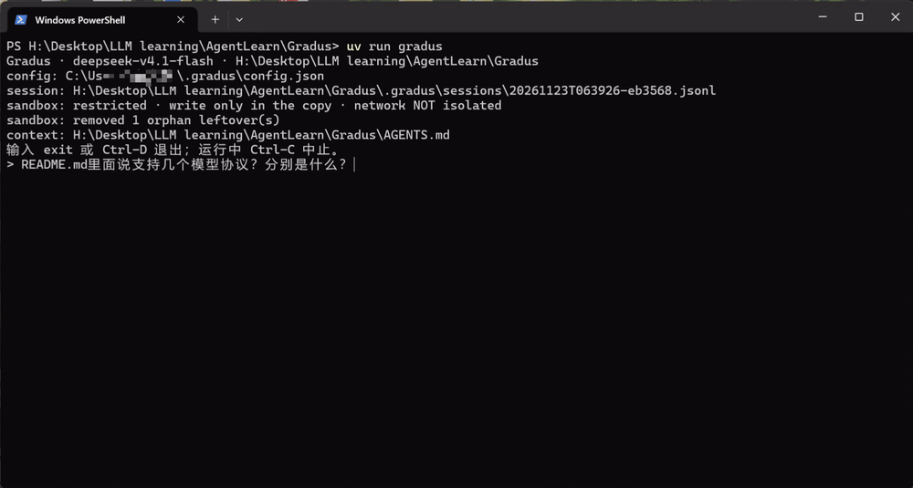

<div align="center">

<picture>
  <source media="(prefers-color-scheme: dark)" srcset="../../docs/banner-dark.svg">
  
</picture>

[](https://github.com/xyzhhh123/Gradus/actions/workflows/ci.yml)


**A layered coding-agent runtime.** Gradus turns model streams into tool-using sessions, and gives every session a private copy of the workspace that merges back when the session ends.

[English](en.md) · [中文](../../README.md) · [日本語](ja.md) · [한국어](ko.md) · [Español](es.md) · [Français](fr.md) · [Deutsch](de.md)

<br>


<sub>One turn: streaming reply → <code>bash</code> tool call → its result.</sub>

</div>

Needs Python 3.13 plus a model: three lines in `.env`. Full steps in [Quick start](#-quick-start).

```bash
git clone https://github.com/xyzhhh123/Gradus.git
cd Gradus && uv sync
uv run gradus
```

## 🎯 Why Gradus

Three claims that separate it from the usual agent harness.

1. 🧠 **The session owns the transcript, not the provider.** History is stored provider-neutral and translated per request, so one session can move between Anthropic, OpenAI, and Gemini-style endpoints mid-conversation. Vendor-private fields such as thinking-block `signature` do not survive the trip; everything else does.
2. 📦 **The agent never edits your workspace directly.** Every session runs against a copy — a `git worktree` when the workspace is a repository, a filtered tree otherwise — and changes merge back only on close. A killed session costs you nothing.
3. 🧰 **It is a runtime, not an app.** Four packages, imports pointing one way. `ai` knows nothing above it, so you can take the protocol layer and leave the rest; `agent` hands you a loop and a facade with no CLI attached.

## ✨ Highlights

- 🔌 **Four model protocols, one internal shape** — Anthropic Messages, OpenAI Chat Completions, OpenAI Responses, and Gemini reduce to one message model plus 12 streaming events. Gemini follows the documented format and is still **in testing** (no live endpoint verified).
- 🔁 **A tool loop with real control** — one async loop, 9 hooks, 8 run-level events, parallel tool execution, `steer` / `follow_up`, cancellation, and retries.
- 🛡️ **Sandboxed execution** — `restricted` on Windows with no admin rights, plus `appcontainer` (deprecated), `docker`, and `local`. See [The sandbox](#-the-sandbox).
- 👥 **More than one agent** — multi-agent teams, background tasks, scheduled jobs, and transcript recall ship as tools in the `coding` layer.
- 🧩 **MCP and extensions** — project-scoped MCP servers with explicit trust and OAuth, plus Python tools, slash commands, and `SKILL.md` skills loaded from `.gradus/`.
- 🐍 **Codemode** — the model writes Python that calls `tools.*`; only `text()` / `return` enters the context.
- 💾 **Sessions and context** — JSONL history, resume, token budgeting, automatic compaction, mid-session model switching.

## 🚀 Quick start

### 💻 Run the CLI

```bash
uv sync
```

Install it as a tool instead, if you would rather not keep a checkout around:

```bash
uv tool install git+https://github.com/xyzhhh123/Gradus
```

The examples below then run as `gradus` rather than `uv run gradus`.

Create `<workspace>/.env` with one connection block:

```ini
GRADUS_SERVICE=kimi-compat
GRADUS_MODEL=kimi-k2.7-code
GRADUS_API_KEY=sk-...
```

```bash
uv run gradus                      # workspace = current directory
uv run gradus --workspace ../app   # or point it somewhere else
uv run gradus --sandbox docker     # auto -> restricted -> appcontainer -> docker -> local
```

A key alone cannot identify a provider, so the service, model, and key are configured together. CLI flags override `.env`, which overrides `~/.gradus/config.json`.

Inside the REPL: `/reload` rebuilds tools and extensions, `/command` and `/skill:name` expand saved prompts, and `exit` / `Ctrl-D` leaves.

<div align="center">

  

  <sub>Recorded in Windows Terminal: one turn, two tool calls, then the answer.</sub>

</div>

### 🌐 Run the web UI

Two processes: the Python host and the browser bundle. Start the host first.

```bash
uv sync --extra web
uv run gradus-serve --port 8765 --token dev
```

It prints the address to open, token included:

```
Gradus web · kimi-k2.7-code · H:\your\workspace
open: http://127.0.0.1:8765/?token=dev
```

The token is not optional: `/ws` closes with 4401 without the right one. Drop `--token` and the host generates a random one and prints that URL instead.

Then pick one:

```bash
cd web && npm install && npm run build   # host serves web/dist — open the printed address
cd web && npm run dev                    # Vite on :5173, proxies /ws to 127.0.0.1:8765
```

With the dev server, open `http://localhost:5173/?token=dev`: the frontend reads `token` from the page URL, so it has to match `--token`. Adding `&mock=1` loads the UI against a scripted connection with no host at all.

Restart the host after editing anything under `gradus/`; the frontend reloads on save by itself.

### 🧪 Run the tests

```bash
uv run pytest -q
```

1002 tests pass offline in about 95 seconds. Another 15 are live checks that skip by default: sandbox contracts need `GRADUS_SANDBOX_LIVE=1`, container tests need `GRADUS_DOCKER_LIVE=1`.

## 🔒 The sandbox

| Backend | When it is used | Boundary |
| --- | --- | --- |
| 🪟 `restricted` | Windows; `auto` picks it first | Restricted token (synthetic SID + logon SID + `Everyone`): reads follow your account, writes only land in the copy and scratch. **No network isolation.** No admin, no extra install. |
| 🪟 `appcontainer` | Windows; only when `restricted` is unavailable | AppContainer token, no network, Job Object kills child processes. **Deprecated**: kept working, no further work. |
| 🐳 `docker` | Docker engine available | Container with `--network none`, memory / CPU / PID limits. **In testing**: kept as a cross-platform fallback, not yet verified against a live engine. |
| 🏠 `local` | Fallback | None; commands run with your user privileges |

A sandbox session never edits your workspace directly. It gets a private copy — `git worktree` when the workspace is a git repository, a filtered tree copy otherwise — and the file tools and commands both operate on that copy. On close, added and modified files are written back, deletions are applied, and a failed merge keeps the copy and prints its path. Copies left behind by a killed process are removed on the next start.

Three boundaries worth stating plainly:

- ⚠️ **`restricted` does not block the network.** The write boundary is real; the network is not. Use `docker` when a command must be offline.
- 🔒 **Command approval stays on.** The copy protects the host from accidental damage; it does not make arbitrary commands safe.
- 🚫 **MCP server processes are not sandboxed.** They run on the host with your privileges. A stdio server's default `cwd` is pointed at the copy so its relative paths line up, but HTTP servers and absolute paths still reach the host.

## 🧱 Architecture

```
gradus/host      web layer       host process, wire protocol, clock
gradus/coding    product layer   config, sessions, tools, permissions, sandbox, MCP, CLI
gradus/agent     control layer   loop, hooks, parallel tools, Agent facade
gradus/ai        protocol layer  providers, streaming events, transport
```

Dependencies only point down. `ai` imports neither `agent` nor `coding`; `agent` never imports `coding`; `coding` never imports `host`.

### 📐 Design principles

1. ⬇️ **Dependencies point down only.** Upper layers may call lower ones; lower layers never see upper ones.
2. 📡 **Events are the interface.** The 12 `ai` events are forwarded unchanged by `agent`, which only adds run-level events.
3. ⚡ **Async all the way down.** `Provider.stream()`, `run_loop()`, and `AgentTool.execute()` are async; the loop never blocks on I/O.
4. 🔧 **Tools belong to the upper layer.** `agent` defines the `AgentTool` protocol; file, search, and shell implementations live in `coding`.

## 🐍 Python API

Run a complete loop offline — no network, no API key:

```python
import asyncio

from gradus.agent.base import LoopConfig
from gradus.agent.loop import run_loop
from gradus.agent.types import AgentDone
from gradus.ai.base import ModelSpec
from gradus.ai.providers.fake import FakeProvider
from gradus.ai.types import UserMessage

spec = ModelSpec(
    provider="fake",
    model="fake",
    base_url="",
    context_window=8192,
    max_output_tokens=1024,
)
provider = FakeProvider(
    spec,
    scripts=[{
        "name": "answer",
        "steps": [
            {"kind": "text", "chunks": ["Hello, ", "I am Gradus"]},
            {"kind": "finish", "reason": "stop"},
        ],
    }],
)

async def main() -> None:
    async for event in run_loop(provider, [UserMessage("hi")], LoopConfig(system="")):
        if isinstance(event, AgentDone):
            print(event.new_messages[-1].content[0].text)

asyncio.run(main())
```

Use a real model through the stateful `Agent` facade:

```python
from gradus.agent.agent import Agent
from gradus.agent.base import LoopConfig
from gradus.ai.base import ModelSpec

spec = ModelSpec(
    provider="anthropic",
    model="claude-sonnet-4-5",
    base_url="https://api.anthropic.com",
    context_window=200_000,
    max_output_tokens=8192,
)

agent = await Agent.connect(
    spec,
    LoopConfig(system="You are a helpful assistant"),
    api_key="sk-...",
)
try:
    async for event in agent.prompt("hi"):
        ...
finally:
    await agent.aclose()
```

`Agent.connect()` creates one `httpx.AsyncClient` and reuses it across runs; `aclose()` closes it. Pass the same `client` to several `connect()` calls to share a pool.

## 📖 Reference

### 🚩 CLI flags

| Flag | Purpose |
| --- | --- |
| `--workspace` | Root for tools and commands (default: current directory) |
| `--sandbox` | `auto` / `local` / `docker` / `appcontainer` / `restricted` |
| `--service` / `--provider` / `--model` / `--base-url` | Override the connection |
| `--resume` / `--session-dir` | Resume a JSONL session, or choose where new ones go |
| `--mcp` / `--config` | Explicit MCP and config file paths |
| `--untrust [path]` | Revoke trust for a project's MCP config, then exit |
| `--reset-sandbox` | Clear orphan copies, AppContainer grants, and the profile |
| `--log` | Append tool and error events to a JSONL file |

### 🧩 Candidate models

The web model picker, the settings panel, and theme switching are documented in **[docs/web-ui.md](../../docs/web-ui.md)**.

### 📁 Layout

```
Gradus/
├── gradus/
│   ├── ai/          # providers, internal protocol, streaming events, transport
│   ├── agent/       # loop, hooks, tool runtime, stateful Agent
│   ├── coding/      # config, sessions, tools, permissions, sandbox, MCP, CLI
│   └── host/        # web host process, wire protocol, clock
├── bench/           # benchmark harness
├── web/             # browser bundle
├── pyproject.toml
└── uv.lock
```

Python 3.13 · runtime dependencies: `httpx`, `httpx2`, `jsonschema`, `mcp` · managed with `uv`.

## 📚 Documentation

| Layer | README | Design | Plan |
| --- | --- | --- | --- |
| `ai` | [README](../../gradus/ai/README.md) | [design](../../gradus/ai/docs/design.md) | [plan](../../gradus/ai/ai_plan.md) |
| `agent` | [README](../../gradus/agent/README.md) | [design](../../gradus/agent/docs/design.md) | [plan](../../gradus/agent/agent_plan.md) |
| `coding` | [README](../../gradus/coding/README.md) | [design](../../gradus/coding/docs/design.md) | [plan](../../gradus/coding/coding_plan.md) |

Background reading in `gradus/coding/docs/`: [sandbox](../../gradus/coding/docs/sandbox.md) · [context design](../../gradus/coding/docs/context_design.md) · [multi-agent](../../gradus/coding/docs/multi_agent.md) · [background tasks](../../gradus/coding/docs/background_tasks.md) · [cron tasks](../../gradus/coding/docs/cron_tasks.md) · [recall](../../gradus/coding/docs/recall.md).

## 🙏 Acknowledgements

Gradus's layering, event model, and tool contract were informed by these open-source projects:

- **Pi** (`@earendil-works/pi-agent-core`): reference for the agent loop, hook system, steering / follow-up, and tool protocol.
- **OpenCode**: reference for API and tool design.

Context budgeting, compaction timing, and recall were compared against these projects; the point-by-point comparison is in [`context_reference.md`](../../gradus/coding/docs/context_reference.md):

- **Codex**: budget as a percentage of the raw window, summary-based compaction.
- **Hermes** (hermes-agent): the most conservative of the set — subtract the output reservation first, then apply a ratio, with a 64K floor and an 85% ceiling.
- **DeepSeek Harness (DSH)**: 80% of the raw window, summary-based compaction.
- **Reasonix** (deepseek-reasonix): 90% of the raw window.

Gradus is released under the [MIT License](../../LICENSE).