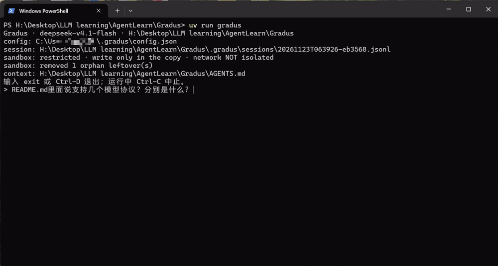

<div align="center">

<picture>
  <source media="(prefers-color-scheme: dark)" srcset="../../docs/banner-dark.svg">
  
</picture>

[](https://github.com/xyzhhh123/Gradus/actions/workflows/ci.yml)


**Un runtime por capas para agentes de código.** Gradus convierte el flujo del modelo en sesiones que usan herramientas, y da a cada sesión una copia privada del workspace que se fusiona de vuelta al terminar.

[English](en.md) · [中文](../../README.md) · [日本語](ja.md) · [한국어](ko.md) · [Español](es.md) · [Français](fr.md) · [Deutsch](de.md)

<br>


<sub>Un turno: respuesta en streaming → llamada a la herramienta <code>bash</code> → su resultado.</sub>

</div>

Necesitas Python 3.13 y un modelo (tres líneas en `.env`). Todos los pasos en [Inicio rápido](#-inicio-rápido).

```bash
git clone https://github.com/xyzhhh123/Gradus.git
cd Gradus && uv sync
uv run gradus
```

## 🎯 Por qué Gradus

Tres afirmaciones que lo separan del arnés de agentes habitual.

1. 🧠 **La transcripción pertenece a la sesión, no al proveedor.** El historial se guarda en una representación neutral y se traduce en cada petición, así que una sesión puede saltar entre endpoints de estilo Anthropic, OpenAI y Gemini a mitad de conversación. Los campos privados del proveedor —como la `signature` de un bloque de razonamiento— no sobreviven al viaje; el resto sí.
2. 📦 **El agente nunca edita tu workspace directamente.** Cada sesión trabaja sobre una copia — un `git worktree` si el workspace es un repositorio, un árbol filtrado si no — y los cambios se fusionan solo al cerrar. Un proceso muerto no te cuesta nada.
3. 🧰 **Es un runtime, no una aplicación.** Cuatro paquetes con importaciones en una sola dirección. `ai` no sabe nada de lo que hay encima, así que puedes llevarte la capa de protocolo y dejar el resto; `agent` te da un bucle y una fachada sin CLI adjunto.

## ✨ Características

- 🔌 **Cuatro protocolos de modelo, una forma interna** — Anthropic Messages, OpenAI Chat Completions, OpenAI Responses y Gemini se reducen a un modelo de mensajes y 12 eventos de streaming. Gemini sigue el formato documentado y está todavía **en pruebas** (sin endpoint real verificado).
- 🔁 **Un bucle de herramientas con control real** — un bucle asíncrono, 9 hooks, 8 eventos de nivel de ejecución, herramientas en paralelo, `steer` / `follow_up`, cancelación y reintentos.
- 🛡️ **Ejecución en sandbox** — `restricted` en Windows sin derechos de administrador, además de `appcontainer` (obsoleto), `docker` y `local`. Ver [El sandbox](#-el-sandbox).
- 👥 **Más de un agente** — equipos multiagente, tareas en segundo plano, tareas programadas y recuperación de transcripciones se incluyen como herramientas en la capa `coding`.
- 🧩 **MCP y extensiones** — servidores MCP por proyecto con confianza explícita y OAuth, además de herramientas Python, comandos de barra y skills `SKILL.md` cargadas desde `.gradus/`.
- 🐍 **Codemode** — el modelo escribe Python que llama a `tools.*`; solo `text()` / `return` entran en el contexto.
- 💾 **Sesiones y contexto** — historial JSONL, reanudación, presupuesto de tokens, compactación automática y cambio de modelo a mitad de sesión.

## 🚀 Inicio rápido

### 💻 Ejecutar la CLI

```bash
uv sync
```

O instálalo como herramienta si prefieres no mantener un clon del repositorio:

```bash
uv tool install git+https://github.com/xyzhhh123/Gradus
```

Los ejemplos siguientes se ejecutan entonces como `gradus` en lugar de `uv run gradus`.

Escribe un bloque de conexión en `<workspace>/.env`:

```ini
GRADUS_SERVICE=kimi-compat
GRADUS_MODEL=kimi-k2.7-code
GRADUS_API_KEY=sk-...
```

```bash
uv run gradus                      # workspace = directorio actual
uv run gradus --workspace ../app   # o apúntalo a otro sitio
uv run gradus --sandbox docker     # auto -> restricted -> appcontainer -> docker -> local
```

Una clave por sí sola no identifica un proveedor, así que servicio, modelo y clave se configuran juntos. Los flags de la CLI tienen prioridad sobre `.env`, que a su vez tiene prioridad sobre `~/.gradus/config.json`.

Dentro del REPL: `/reload` reconstruye herramientas y extensiones, `/command` y `/skill:name` expanden prompts guardados, y `exit` / `Ctrl-D` sale.

<div align="center">

  

  <sub>Grabado en Windows Terminal: un turno, dos llamadas a herramientas y luego la respuesta.</sub>

</div>

### 🌐 Ejecutar la interfaz web

Dos procesos: el host de Python y el bundle del navegador. Arranca primero el host.

```bash
uv sync --extra web
uv run gradus-serve --port 8765 --token dev
```

Imprime la dirección a abrir, con el token incluido:

```
Gradus web · kimi-k2.7-code · H:\your\workspace
open: http://127.0.0.1:8765/?token=dev
```

El token no es opcional: `/ws` se cierra con 4401 sin el correcto. Omite `--token` y el host genera uno aleatorio e imprime esa URL.

Después elige una opción:

```bash
cd web && npm install && npm run build   # el host sirve web/dist — abre la dirección impresa
cd web && npm run dev                    # Vite en :5173, hace proxy de /ws a 127.0.0.1:8765
```

Con el servidor de desarrollo, abre `http://localhost:5173/?token=dev`: el frontend lee el `token` de la URL de la página, así que debe coincidir con `--token`. Añadiendo `&mock=1` la interfaz se carga contra una conexión guionizada, sin host alguno.

Reinicia el host tras editar cualquier cosa bajo `gradus/`; el frontend se recarga solo al guardar.

### 🧪 Ejecutar las pruebas

```bash
uv run pytest -q
```

1002 pruebas pasan en línea, en unos 95 segundos. Otras 15 son comprobaciones en vivo que se omiten por defecto: los contratos de sandbox necesitan `GRADUS_SANDBOX_LIVE=1` y las pruebas de contenedor `GRADUS_DOCKER_LIVE=1`.

## 🔒 El sandbox

| Backend | Cuándo se usa | Límite |
| --- | --- | --- |
| 🪟 `restricted` | Windows; `auto` lo elige primero | Token restringido (SID sintético + SID de inicio de sesión + `Everyone`): las lecturas siguen tu cuenta, las escrituras solo caen en la copia y en el scratch. **Sin aislamiento de red.** Sin administrador, sin instalación extra. |
| 🪟 `appcontainer` | Windows; solo si `restricted` no está disponible | Token AppContainer, sin red, Job Object mata los procesos hijos. **Obsoleto**: sigue funcionando, sin más trabajo. |
| 🐳 `docker` | Motor Docker disponible | Contenedor con `--network none`, límites de memoria / CPU / PID. **En pruebas**: se mantiene como alternativa multiplataforma, aún sin verificar contra un motor real. |
| 🏠 `local` | Alternativa final | Ninguno; los comandos corren con los privilegios de tu usuario |

Una sesión en sandbox nunca edita tu workspace directamente. Recibe una copia privada — `git worktree` si el workspace es un repositorio git, una copia de árbol filtrada si no — y tanto las herramientas de archivo como los comandos operan sobre esa copia. Al cerrar, los archivos añadidos y modificados se escriben de vuelta, las eliminaciones se aplican, y una fusión fallida conserva la copia e imprime su ruta. Las copias que deja un proceso terminado a la fuerza se limpian en el siguiente arranque.

Tres límites que conviene decir sin rodeos:

- ⚠️ **`restricted` no bloquea la red.** El límite de escritura es real; el de red no. Usa `docker` cuando un comando deba estar sin conexión.
- 🔒 **La aprobación de comandos sigue activa.** La copia protege al host de daños accidentales; no hace que comandos arbitrarios sean seguros.
- 🚫 **Los procesos de servidores MCP no están en el sandbox.** Corren en el host con tus privilegios. El `cwd` por defecto de un servidor stdio apunta a la copia para que sus rutas relativas cuadren, pero los servidores HTTP y las rutas absolutas siguen llegando al host.

## 🧱 Arquitectura

```
gradus/host      web layer      proceso host, protocolo wire, reloj
gradus/coding    product layer  configuración, sesiones, herramientas, permisos, sandbox, MCP, CLI
gradus/agent     control layer  bucle, hooks, herramientas en paralelo, fachada Agent
gradus/ai        protocol layer proveedores, eventos de streaming, transporte
```

Las dependencias solo apuntan hacia abajo. `ai` no importa ni `agent` ni `coding`; `agent` nunca importa `coding`; `coding` nunca importa `host`.

### 📐 Principios de diseño

1. ⬇️ **Las dependencias solo apuntan hacia abajo.** Las capas superiores pueden llamar a las inferiores; las inferiores nunca ven a las superiores.
2. 📡 **Los eventos son la interfaz.** Los 12 eventos de `ai` los reenvía `agent` sin cambios, y solo añade eventos de nivel de ejecución.
3. ⚡ **Asíncrono de arriba abajo.** `Provider.stream()`, `run_loop()` y `AgentTool.execute()` son asíncronos; el bucle nunca se bloquea en I/O.
4. 🔧 **Las herramientas pertenecen a la capa superior.** `agent` define el protocolo `AgentTool`; las implementaciones de archivos, búsqueda y shell viven en `coding`.

## 🐍 API de Python

Ejecuta un bucle completo sin conexión — sin red ni clave de API:

```python
import asyncio

from gradus.agent.base import LoopConfig
from gradus.agent.loop import run_loop
from gradus.agent.types import AgentDone
from gradus.ai.base import ModelSpec
from gradus.ai.providers.fake import FakeProvider
from gradus.ai.types import UserMessage

spec = ModelSpec(
    provider="fake",
    model="fake",
    base_url="",
    context_window=8192,
    max_output_tokens=1024,
)
provider = FakeProvider(
    spec,
    scripts=[{
        "name": "answer",
        "steps": [
            {"kind": "text", "chunks": ["Hello, ", "I am Gradus"]},
            {"kind": "finish", "reason": "stop"},
        ],
    }],
)

async def main() -> None:
    async for event in run_loop(provider, [UserMessage("hi")], LoopConfig(system="")):
        if isinstance(event, AgentDone):
            print(event.new_messages[-1].content[0].text)

asyncio.run(main())
```

Usa un modelo real a través de la fachada con estado `Agent`:

```python
from gradus.agent.agent import Agent
from gradus.agent.base import LoopConfig
from gradus.ai.base import ModelSpec

spec = ModelSpec(
    provider="anthropic",
    model="claude-sonnet-4-5",
    base_url="https://api.anthropic.com",
    context_window=200_000,
    max_output_tokens=8192,
)

agent = await Agent.connect(
    spec,
    LoopConfig(system="You are a helpful assistant"),
    api_key="sk-...",
)
try:
    async for event in agent.prompt("hi"):
        ...
finally:
    await agent.aclose()
```

`Agent.connect()` crea un `httpx.AsyncClient` y lo reutiliza entre ejecuciones; `aclose()` lo cierra. Pasa el mismo `client` a varias llamadas a `connect()` para compartir el pool.

## 📖 Referencia

### 🚩 Flags de la CLI

| Flag | Propósito |
| --- | --- |
| `--workspace` | Raíz de herramientas y comandos (por defecto: directorio actual) |
| `--sandbox` | `auto` / `local` / `docker` / `appcontainer` / `restricted` |
| `--service` / `--provider` / `--model` / `--base-url` | Sobrescriben la conexión |
| `--resume` / `--session-dir` | Reanuda una sesión JSONL o elige dónde van las nuevas |
| `--mcp` / `--config` | Rutas explícitas de MCP y del archivo de configuración |
| `--untrust [path]` | Revoca la confianza de la configuración MCP de un proyecto y sale |
| `--reset-sandbox` | Limpia copias huérfanas, concesiones de AppContainer y el perfil |
| `--log` | Añade eventos de herramientas y errores a un JSONL |

### 🧩 Modelos candidatos

El selector de modelos de la web, el panel de ajustes y el cambio de tema están documentados en **[docs/web-ui.md](../../docs/web-ui.md)**.

### 📁 Estructura

```
Gradus/
├── gradus/
│   ├── ai/          # proveedores, protocolo interno, eventos de streaming, transporte
│   ├── agent/       # bucle, hooks, runtime de herramientas, Agent con estado
│   ├── coding/      # configuración, sesiones, herramientas, permisos, sandbox, MCP, CLI
│   └── host/        # proceso host web, protocolo wire, reloj
├── bench/           # arnés de benchmarks
├── web/             # bundle del navegador
├── pyproject.toml
└── uv.lock
```

Python 3.13 · dependencias de ejecución: `httpx`, `httpx2`, `jsonschema`, `mcp` · gestionadas con `uv`.

## 📚 Documentación

| Capa | README | Diseño | Plan |
| --- | --- | --- | --- |
| `ai` | [README](../../gradus/ai/README.md) | [diseño](../../gradus/ai/docs/design.md) | [plan](../../gradus/ai/ai_plan.md) |
| `agent` | [README](../../gradus/agent/README.md) | [diseño](../../gradus/agent/docs/design.md) | [plan](../../gradus/agent/agent_plan.md) |
| `coding` | [README](../../gradus/coding/README.md) | [diseño](../../gradus/coding/docs/design.md) | [plan](../../gradus/coding/coding_plan.md) |

Lecturas adicionales en `gradus/coding/docs/`: [sandbox](../../gradus/coding/docs/sandbox.md) · [diseño de contexto](../../gradus/coding/docs/context_design.md) · [multiagente](../../gradus/coding/docs/multi_agent.md) · [tareas en segundo plano](../../gradus/coding/docs/background_tasks.md) · [tareas programadas](../../gradus/coding/docs/cron_tasks.md) · [recuperación](../../gradus/coding/docs/recall.md).

## 🙏 Agradecimientos

El diseño por capas, el modelo de eventos y el contrato de herramientas de Gradus se inspiraron en estos proyectos de código abierto:

- **Pi** (`@earendil-works/pi-agent-core`): referencia para el bucle del agente, el sistema de hooks, steering / follow-up y el protocolo de herramientas.
- **OpenCode**: referencia para el diseño de la API y de las herramientas.

## 📄 Licencia

[MIT](../../LICENSE)
