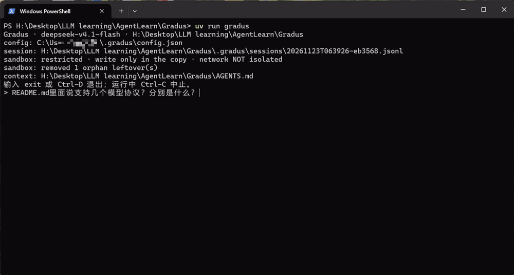

<div align="center">

<picture>
  <source media="(prefers-color-scheme: dark)" srcset="../../docs/banner-dark.svg">
  
</picture>

[](https://github.com/xyzhhh123/Gradus/actions/workflows/ci.yml)


**Un runtime d'agent de code en couches.** Gradus transforme le flux du modèle en sessions qui utilisent des outils, et donne à chaque session une copie privée du workspace, fusionnée dans l'hôte à la fermeture.

[English](en.md) · [中文](../../README.md) · [日本語](ja.md) · [한국어](ko.md) · [Español](es.md) · [Français](fr.md) · [Deutsch](de.md)

<br>


<sub>Un tour : réponse en streaming → appel de l'outil <code>bash</code> → son résultat.</sub>

</div>

Il faut Python 3.13 et un modèle (trois lignes dans `.env`). Toutes les étapes dans [Démarrage rapide](#-démarrage-rapide).

```bash
git clone https://github.com/xyzhhh123/Gradus.git
cd Gradus && uv sync
uv run gradus
```

## 🎯 Pourquoi Gradus

Trois affirmations qui le distinguent du harnais d'agent habituel.

1. 🧠 **La transcription appartient à la session, pas au fournisseur.** L'historique est stocké dans une représentation neutre et traduit à chaque requête, si bien qu'une session peut passer d'un endpoint de style Anthropic à OpenAI ou Gemini en pleine conversation. Les champs propres au fournisseur — comme la `signature` d'un bloc de raisonnement — ne survivent pas au trajet ; tout le reste oui.
2. 📦 **L'agent n'édite jamais ton workspace directement.** Chaque session travaille sur une copie — un `git worktree` si le workspace est un dépôt, un arbre filtré sinon — et les changements ne sont fusionnés qu'à la fermeture. Un processus tué ne te coûte rien.
3. 🧰 **C'est un runtime, pas une application.** Quatre paquets, des imports à sens unique. `ai` ne sait rien de ce qui est au-dessus, tu peux donc ne prendre que la couche protocole ; `agent` fournit une boucle et une façade, sans CLI attachée.

## ✨ Fonctionnalités

- 🔌 **Quatre protocoles de modèle, une seule forme interne** — Anthropic Messages, OpenAI Chat Completions, OpenAI Responses et Gemini se réduisent à un modèle de messages et 12 événements de streaming. Gemini suit le format documenté et reste **en test** (aucun endpoint réel vérifié).
- 🔁 **Une boucle d'outils vraiment contrôlable** — une boucle asynchrone, 9 hooks, 8 événements de niveau exécution, outils en parallèle, `steer` / `follow_up`, annulation et reprises.
- 🛡️ **Exécution en sandbox** — `restricted` sous Windows sans droits administrateur, plus `appcontainer` (déprécié), `docker` et `local`. Voir [Le sandbox](#-le-sandbox).
- 👥 **Plus d'un agent** — équipes multi-agents, tâches d'arrière-plan, tâches planifiées et rappel de transcription sont fournis comme outils dans la couche `coding`.
- 🧩 **MCP et extensions** — serveurs MCP par projet avec confiance explicite et OAuth, plus des outils Python, des commandes slash et des skills `SKILL.md` chargées depuis `.gradus/`.
- 🐍 **Codemode** — le modèle écrit du Python qui appelle `tools.*` ; seuls `text()` / `return` entrent dans le contexte.
- 💾 **Sessions et contexte** — historique JSONL, reprise, budget de jetons, compactage automatique, changement de modèle en cours de session.

## 🚀 Démarrage rapide

### 💻 Lancer la CLI

```bash
uv sync
```

Ou installe-la comme outil si tu préfères ne pas garder de copie du dépôt :

```bash
uv tool install git+https://github.com/xyzhhh123/Gradus
```

Les exemples ci-dessous s'exécutent alors avec `gradus` au lieu de `uv run gradus`.

Écris un bloc de connexion dans `<workspace>/.env` :

```ini
GRADUS_SERVICE=kimi-compat
GRADUS_MODEL=kimi-k2.7-code
GRADUS_API_KEY=sk-...
```

```bash
uv run gradus                      # workspace = répertoire courant
uv run gradus --workspace ../app   # ou pointe-le ailleurs
uv run gradus --sandbox docker     # auto -> restricted -> appcontainer -> docker -> local
```

Une clé seule ne suffit pas à identifier un fournisseur : service, modèle et clé se configurent ensemble. Les flags de la CLI priment sur `.env`, qui prime sur `~/.gradus/config.json`.

Dans le REPL : `/reload` reconstruit les outils et extensions, `/command` et `/skill:name` déploient des prompts enregistrés, et `exit` / `Ctrl-D` en sort.

<div align="center">

  

  <sub>Enregistré dans Windows Terminal : un tour, deux appels d'outils, puis la réponse.</sub>

</div>

### 🌐 Lancer l'interface web

Deux processus : l'hôte Python et le bundle navigateur. Démarre l'hôte :

```bash
uv sync --extra web
uv run gradus-serve --port 8765 --token dev
```

Il affiche l'adresse avec le jeton inclus. Compiler le bundle, le proxy de développement, les règles du jeton, le mode mock, le sélecteur de modèles et le changement de thème : **[docs/web-ui.md](../../docs/web-ui.md)**.

### 🧪 Lancer les tests

```bash
uv run pytest -q
```

1002 tests passent hors ligne, en 95 secondes environ. 15 autres sont des vérifications en conditions réelles, ignorées par défaut : les contrats de sandbox demandent `GRADUS_SANDBOX_LIVE=1`, les tests de conteneur `GRADUS_DOCKER_LIVE=1`.

## 🔒 Le sandbox

| Backend | Quand il est utilisé | Limite |
| --- | --- | --- |
| 🪟 `restricted` | Windows ; `auto` le choisit en premier | Jeton restreint (SID synthétique + SID de session + `Everyone`) : les lectures suivent ton compte, les écritures n'atterrissent que dans la copie et le scratch. **Aucune isolation réseau.** Sans administrateur, sans installation supplémentaire. |
| 🪟 `appcontainer` | Windows ; seulement si `restricted` est indisponible | Jeton AppContainer, pas de réseau, un Job Object tue les processus enfants. **Déprécié** : maintenu fonctionnel, plus de travail dessus. |
| 🐳 `docker` | Moteur Docker disponible | Conteneur avec `--network none`, limites mémoire / CPU / PID. **En test** : conservé comme repli multiplateforme, pas encore vérifié contre un vrai moteur. |
| 🏠 `local` | Repli | Aucun ; les commandes tournent avec tes privilèges |

Une session en sandbox n'édite jamais ton workspace directement. Elle reçoit une copie privée — `git worktree` si le workspace est un dépôt git, sinon une copie d'arbre filtrée — et les outils de fichiers comme les commandes opèrent sur cette copie. À la fermeture, les fichiers ajoutés et modifiés sont réécrits, les suppressions appliquées, et une fusion ratée conserve la copie et affiche son chemin. Les copies laissées par un processus tué sont nettoyées au démarrage suivant.

Trois limites à dire sans détour :

- ⚠️ **`restricted` ne bloque pas le réseau.** La limite d'écriture est réelle, la limite réseau non. Utilise `docker` quand une commande doit être hors ligne.
- 🔒 **L'approbation des commandes reste active.** La copie protège l'hôte des dégâts accidentels ; elle ne rend pas des commandes arbitraires sûres.
- 🚫 **Les processus de serveurs MCP ne sont pas dans le sandbox.** Ils tournent sur l'hôte avec tes privilèges. Le `cwd` par défaut d'un serveur stdio pointe sur la copie pour que ses chemins relatifs concordent, mais les serveurs HTTP et les chemins absolus atteignent toujours l'hôte.

## 🧱 Architecture

```
gradus/host      web layer      processus hôte, protocole wire, horloge
gradus/coding    product layer  configuration, sessions, outils, permissions, sandbox, MCP, CLI
gradus/agent     control layer  boucle, hooks, outils parallèles, façade Agent
gradus/ai        protocol layer fournisseurs, événements de streaming, transport
```

Les dépendances ne pointent que vers le bas. `ai` n'importe ni `agent` ni `coding` ; `agent` n'importe jamais `coding` ; `coding` n'importe jamais `host`.

### 📐 Principes de conception

1. ⬇️ **Les dépendances ne pointent que vers le bas.** Les couches hautes peuvent appeler les basses ; les basses ne voient jamais les hautes.
2. 📡 **Les événements sont l'interface.** Les 12 événements de `ai` sont retransmis tels quels par `agent`, qui n'ajoute que des événements de niveau exécution.
3. ⚡ **Asynchrone de bout en bout.** `Provider.stream()`, `run_loop()` et `AgentTool.execute()` sont asynchrones ; la boucle ne bloque jamais sur de l'I/O.
4. 🔧 **Les outils appartiennent à la couche haute.** `agent` définit le protocole `AgentTool` ; les implémentations fichiers, recherche et shell vivent dans `coding`.

## 🐍 API Python

`run_loop()` prend un fournisseur et une liste de messages et exécute un tour ; `Agent` conserve l'état entre les tours et possède le pool de connexions. Les deux sont asynchrones et n'ont besoin ni de la CLI, ni du sandbox, ni d'un fichier de configuration.

Exécute un tour hors ligne — sans réseau ni clé d'API :

```python
async for event in run_loop(provider, [UserMessage("hi")], LoopConfig(system="")):
    if isinstance(event, AgentDone):
        print(event.new_messages[-1].content[0].text)
```

Les exemples complets — construire le faux fournisseur, parler à un vrai modèle, partager un pool de connexions — sont dans **[docs/python-api.md](../../docs/python-api.md)**.

## 📖 Référence

### 🚩 Flags de la CLI

Tous les flags, l'ordre de priorité de la configuration et les commandes du REPL : **[docs/cli.md](../../docs/cli.md)**.

### 📁 Structure

```
Gradus/
├── gradus/   # ai · agent · coding · host
├── bench/    # harnais de benchmarks
└── web/      # bundle navigateur
```

Python 3.13 · dépendances d'exécution : `httpx`, `httpx2`, `jsonschema`, `mcp` · gérées avec `uv`.

## 📚 Documentation

| Couche | README | Conception | Plan |
| --- | --- | --- | --- |
| `ai` | [README](../../gradus/ai/README.md) | [conception](../../gradus/ai/docs/design.md) | [plan](../../gradus/ai/ai_plan.md) |
| `agent` | [README](../../gradus/agent/README.md) | [conception](../../gradus/agent/docs/design.md) | [plan](../../gradus/agent/agent_plan.md) |
| `coding` | [README](../../gradus/coding/README.md) | [conception](../../gradus/coding/docs/design.md) | [plan](../../gradus/coding/coding_plan.md) |

Lectures complémentaires dans `gradus/coding/docs/` : [sandbox](../../gradus/coding/docs/sandbox.md) · [conception du contexte](../../gradus/coding/docs/context_design.md) · [multi-agents](../../gradus/coding/docs/multi_agent.md) · [tâches d'arrière-plan](../../gradus/coding/docs/background_tasks.md) · [tâches planifiées](../../gradus/coding/docs/cron_tasks.md) · [rappel](../../gradus/coding/docs/recall.md).

## 🙏 Remerciements

Le découpage en couches, le modèle d'événements et le contrat d'outils de Gradus se sont inspirés de ces projets open source :

- **Pi** (`@earendil-works/pi-agent-core`) : référence pour la boucle de l'agent, le système de hooks, le steering / follow-up et le protocole d'outils.
- **OpenCode** : référence pour la conception de l'API et des outils.

Le budget de contexte, le moment du compactage et la stratégie de rappel ont été comparés à ces projets ; la comparaison point par point est dans [`context_reference.md`](../../gradus/coding/docs/context_reference.md) :

- **Codex** : budget en pourcentage de la fenêtre brute, compactage par résumé.
- **Hermes** (hermes-agent) : l'option la plus prudente — on déduit d'abord la réserve de sortie, puis on applique un ratio, avec un plancher de 64K et un plafond de 85 %.
- **DeepSeek Harness (DSH)** : 80 % de la fenêtre brute, compactage par résumé.
- **Reasonix** (deepseek-reasonix) : 90 % de la fenêtre brute.

Gradus est publié sous [licence MIT](../../LICENSE).