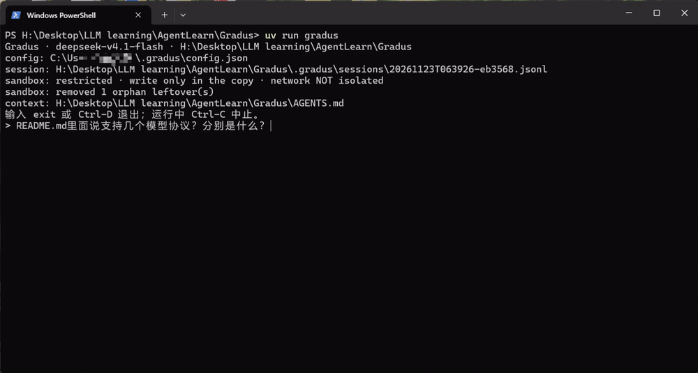

<div align="center">

<picture>
  <source media="(prefers-color-scheme: dark)" srcset="../../docs/banner-dark.svg">
  
</picture>

[](https://github.com/xyzhhh123/Gradus/actions/workflows/ci.yml)


**階層化されたコーディングエージェントランタイム。** Gradus はモデルのストリームをツールを使うセッションに変え、各セッションにワークスペースのプライベートコピーを与え、セッション終了時にホストへマージして戻します。

[English](en.md) · [中文](../../README.md) · [日本語](ja.md) · [한국어](ko.md) · [Español](es.md) · [Français](fr.md) · [Deutsch](de.md)

<br>


<sub>1 ターン：ストリーミング応答 → <code>bash</code> ツール呼び出し → その結果。</sub>

</div>

Python 3.13 とモデルが必要です — `.env` に 3 行。手順は[クイックスタート](#-クイックスタート)にあります。

```bash
git clone https://github.com/xyzhhh123/Gradus.git
cd Gradus && uv sync
uv run gradus
```

## 🎯 Gradus とは

一般的なエージェントハーネスと異なる、3 つの主張があります。

1. 🧠 **トランスクリプトはセッションが持ち、プロバイダーは持たない。** 履歴はプロバイダー中立の表現で保存され、リクエストごとに翻訳されるため、ひとつのセッションが会話の途中で Anthropic・OpenAI・Gemini 形式のエンドポイントへ移動できます。thinking ブロックの `signature` のようなベンダー固有フィールドは引き継がれませんが、それ以外はすべて引き継がれます。
2. 📦 **エージェントはワークスペースを直接編集しない。** すべてのセッションはコピー上で動作し（ワークスペースがリポジトリなら `git worktree`、そうでなければフィルタ済みのツリーコピー）、変更は終了時にのみマージされます。プロセスが強制終了されても損害はありません。
3. 🧰 **これはランタイムであり、アプリではない。** 4 つのパッケージ、import は一方向。`ai` は上位層を一切知らないため、プロトコル層だけを取り出すこともできます。`agent` はループとファサードを提供し、CLI は付いてきません。

## ✨ 機能

- 🔌 **4 つのモデルプロトコル、1 つの内部表現** — Anthropic Messages、OpenAI Chat Completions、OpenAI Responses、Gemini を、1 つのメッセージモデルと 12 個のストリーミングイベントに還元します。Gemini は公式フォーマットに沿って実装していますが、**テスト中**です（実際のエンドポイントでは未検証）。
- 🔁 **制御可能なツールループ** — 単一の非同期ループ、9 個のフック、8 個の実行レベルイベント、並列ツール実行、`steer` / `follow_up`、キャンセル、リトライ。
- 🛡️ **サンドボックス実行** — Windows で管理者権限不要の `restricted`、ほかに `appcontainer`（非推奨）、`docker`、`local`。[サンドボックス](#-サンドボックス)を参照。
- 👥 **エージェントは 1 つだけではない** — マルチエージェントチーム、バックグラウンドタスク、スケジュール実行、トランスクリプトの recall が、`coding` 層のツールとして同梱されています。
- 🧩 **MCP と拡張** — プロジェクト単位の MCP サーバー（明示的な信頼 + OAuth）、さらに `.gradus/` から読み込む Python ツール、スラッシュコマンド、`SKILL.md` スキル。
- 🐍 **Codemode** — モデルが `tools.*` を呼ぶ Python を書き、`text()` / `return` の結果だけがコンテキストに入ります。
- 💾 **セッションとコンテキスト** — JSONL 履歴、再開、トークン予算、自動コンパクション、セッション途中でのモデル切り替え。

## 🚀 クイックスタート

### 💻 CLI を実行する

```bash
uv sync
```

リポジトリを残したくない場合は、ツールとしてインストールできます：

```bash
uv tool install git+https://github.com/xyzhhh123/Gradus
```

以降の例は `uv run gradus` を `gradus` に読み替えてください。

`<workspace>/.env` に接続設定をひとまとまり書きます：

```ini
GRADUS_SERVICE=kimi-compat
GRADUS_MODEL=kimi-k2.7-code
GRADUS_API_KEY=sk-...
```

```bash
uv run gradus                      # workspace はカレントディレクトリ
uv run gradus --workspace ../app   # 別の場所を指定することもできます
uv run gradus --sandbox docker     # auto -> restricted -> appcontainer -> docker -> local
```

キーだけではプロバイダーを特定できないため、service・model・key はまとめて設定します。優先順位は CLI フラグ、次に `.env`、次に `~/.gradus/config.json` です。

REPL 内では、`/reload` がツールと拡張を再構築し、`/command` と `/skill:name` が保存済みプロンプトを展開し、`exit` または `Ctrl-D` で抜けます。

<div align="center">

  

  <sub>Windows Terminal での実録：1 ターン、ツール呼び出し 2 回、そして回答。</sub>

</div>

### 🌐 Web UI を実行する

プロセスは 2 つ：Python ホストとブラウザ用バンドル。ホストを先に起動します：

```bash
uv sync --extra web
uv run gradus-serve --port 8765 --token dev
```

トークン込みのアドレスが出力されます。バンドルのビルド、開発プロキシ、トークンの規則、mock モード、モデル選択とテーマ切り替えは **[docs/web-ui.md](../../docs/web-ui.md)** を参照。

### 🧪 テストを実行する

```bash
uv run pytest -q
```

オフラインで 1002 件が約 95 秒で通過します。別に 15 件の実機チェックが既定でスキップされます。サンドボックス契約は `GRADUS_SANDBOX_LIVE=1`、コンテナテストは `GRADUS_DOCKER_LIVE=1` が必要です。

## 🔒 サンドボックス

| バックエンド | 使われるとき | 境界 |
| --- | --- | --- |
| 🪟 `restricted` | Windows。`auto` が最初に選ぶ | 制限付きトークン（合成 SID + ログオン SID + `Everyone`）。読み取りはアカウントに従い、書き込みはコピーとスクラッチにのみ落ちます。**ネットワーク分離はありません。** 管理者不要、追加インストールも不要。 |
| 🪟 `appcontainer` | Windows。`restricted` が使えないときのみ | AppContainer トークン、ネットワークなし、Job Object が子プロセスを終了させます。**非推奨**：動作は維持しますが、それ以上の作業は行いません。 |
| 🐳 `docker` | Docker エンジンがある場合 | `--network none`、メモリ / CPU / PID 制限付きのコンテナ。**テスト中**：クロスプラットフォームのフォールバックとして維持していますが、実際のエンジンでは未検証。 |
| 🏠 `local` | フォールバック | なし。コマンドは自分のユーザー権限で実行されます |

サンドボックスのセッションはワークスペースを直接編集しません。プライベートなコピー（ワークスペースが git リポジトリなら `git worktree`、そうでなければフィルタ済みのツリーコピー）を受け取り、ファイルツールもコマンドもそのコピー上で動作します。終了時に、追加・変更されたファイルは書き戻され、削除は適用されます。マージに失敗した場合はコピーを保持してパスを表示します。強制終了されたプロセスが残したコピーは、次回起動時に削除されます。

率直に書いておくべき境界が 3 つあります：

- ⚠️ **`restricted` はネットワークを遮断しません。** 書き込みの境界は本物ですが、ネットワークはそうではありません。コマンドを必ずオフラインにしたい場合は `docker` を使ってください。
- 🔒 **コマンド承認は有効なままです。** コピーはホストを誤操作から守りますが、任意のコマンドを安全にするわけではありません。
- 🚫 **MCP サーバーのプロセスはサンドボックス内にありません。** それらはあなたの権限でホスト上で動作します。stdio サーバーの既定の `cwd` は相対パスが合うようコピーを指しますが、HTTP サーバーと絶対パスはホストに届きます。

## 🧱 アーキテクチャ

```
gradus/host      web layer      ホストプロセス、wire プロトコル、クロック
gradus/coding    product layer  設定、セッション、ツール、権限、サンドボックス、MCP、CLI
gradus/agent     control layer  ループ、フック、並列ツール、Agent ファサード
gradus/ai        protocol layer プロバイダー、ストリーミングイベント、トランスポート
```

依存は下向きのみです。`ai` は `agent` も `coding` も import せず、`agent` は `coding` を import せず、`coding` は `host` を import しません。

### 📐 設計原則

1. ⬇️ **依存は下向きのみ。** 上位層は下位層を呼べますが、下位層は上位層を決して見ません。
2. 📡 **イベントがインターフェース。** 12 個の `ai` イベントは `agent` によってそのまま転送され、`agent` が追加するのは実行レベルイベントだけです。
3. ⚡ **全体が非同期。** `Provider.stream()`、`run_loop()`、`AgentTool.execute()` はすべて async で、ループが I/O でブロックすることはありません。
4. 🔧 **ツールは上位層に属する。** `agent` が `AgentTool` プロトコルを定義し、ファイル・検索・シェルの実装は `coding` にあります。

## 🐍 Python API

`run_loop()` は provider とメッセージ列を受け取って 1 ターン実行します。`Agent` は同じループの上でターンをまたいだ状態と接続プールを保持します。どちらも async で、CLI もサンドボックスも設定ファイルも要りません。

ネットワークも API キーもなしで 1 ターン動かす：

```python
async for event in run_loop(provider, [UserMessage("hi")], LoopConfig(system="")):
    if isinstance(event, AgentDone):
        print(event.new_messages[-1].content[0].text)
```

完全な例 —— fake provider の組み立て、実モデルへの接続、接続プールの共有 —— は **[docs/python-api.md](../../docs/python-api.md)** にあります。

## 📖 リファレンス

### 🚩 CLI フラグ

すべてのフラグ、設定の優先順位、REPL のコマンド：**[docs/cli.md](../../docs/cli.md)**。

### 📁 ディレクトリ構成

```
Gradus/
├── gradus/   # ai · agent · coding · host
├── bench/    # ベンチマークハーネス
└── web/      # ブラウザ用バンドル
```

Python 3.13 · 実行時依存：`httpx`、`httpx2`、`jsonschema`、`mcp` · `uv` で管理。

## 📚 ドキュメント

| 層 | README | 設計 | 計画 |
| --- | --- | --- | --- |
| `ai` | [README](../../gradus/ai/README.md) | [設計](../../gradus/ai/docs/design.md) | [計画](../../gradus/ai/ai_plan.md) |
| `agent` | [README](../../gradus/agent/README.md) | [設計](../../gradus/agent/docs/design.md) | [計画](../../gradus/agent/agent_plan.md) |
| `coding` | [README](../../gradus/coding/README.md) | [設計](../../gradus/coding/docs/design.md) | [計画](../../gradus/coding/coding_plan.md) |

`gradus/coding/docs/` の関連資料：[サンドボックス](../../gradus/coding/docs/sandbox.md) · [コンテキスト設計](../../gradus/coding/docs/context_design.md) · [マルチエージェント](../../gradus/coding/docs/multi_agent.md) · [バックグラウンドタスク](../../gradus/coding/docs/background_tasks.md) · [スケジュール実行](../../gradus/coding/docs/cron_tasks.md) · [recall](../../gradus/coding/docs/recall.md)。

## 🙏 謝辞

Gradus の階層構造、イベントモデル、ツール契約は、以下のオープンソースプロジェクトを参考にしています：

- **Pi**（`@earendil-works/pi-agent-core`）：エージェントループ、フック機構、steering / follow-up、ツールプロトコルの参照元。
- **OpenCode**：API とツール設計の参照元。

コンテキスト予算、圧縮のタイミング、recall の戦略は以下のプロジェクトと比較しました。項目ごとの比較は [`context_reference.md`](../../gradus/coding/docs/context_reference.md) にあります：

- **Codex**：生のウィンドウに対する割合で予算を決め、要約で圧縮。
- **Hermes**（hermes-agent）：もっとも保守的 —— 出力の予約分を先に引き、そのうえで割合を適用。64K の下限と 85% の上限を持つ。
- **DeepSeek Harness（DSH）**：生のウィンドウの 80%、要約で圧縮。
- **Reasonix**（deepseek-reasonix）：生のウィンドウの 90%。

Gradus は [MIT ライセンス](../../LICENSE) で公開されています。